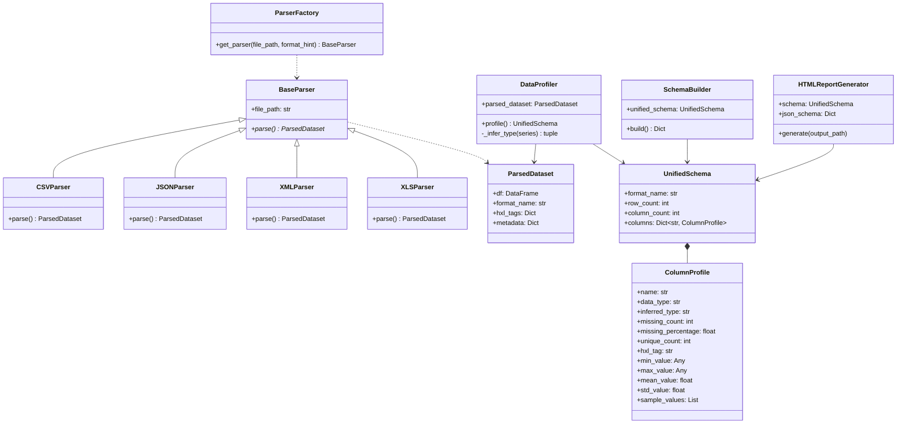
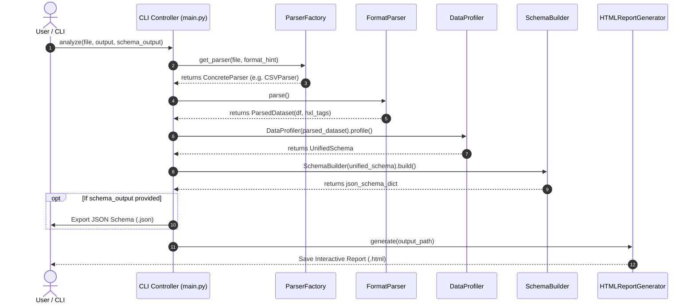

# THE UNIVERSITY OF ZAMBIA
## SCHOOL OF NATURAL AND APPLIED SCIENCES
### DEPARTMENT OF COMPUTING AND INFORMATICS

---

# FINAL YEAR PROJECT REPORT

### ACADEMIC YEAR 2026

---

## Humanitarian Data Schema Analyzer: A Unified Tool for Automated Schema Profiling and Standardisation Across Heterogeneous Humanitarian Data Formats

---

**A Final Year Project Report Submitted to the Department of Computing and Informatics in partial fulfilment of the requirements for the award of Bachelor in Computer Science in Software Engineering**

**By**  
**Bwanga Nyirenda**  
**Computer Number: 2022081501**  

**Supervisor:** Mr. Mofya Phiri  
**Date of Submission:** 30th September 2026  

---

## DECLARATION

I declare that this final year project report is my own work and has been prepared in accordance with the academic requirements of the University of Zambia. All sources of information, ideas, data, software, images, and other material that are not my own have been appropriately acknowledged and referenced.

Where this project was undertaken as part of a group, I have clearly identified my individual contributions and have not presented the work of other group members as my own.

**Student Name:** Bwanga Nyirenda  
**Signature:** ________________________________________________________________________________  
**Computer Number:** 2022081501  
**Date:** 30th September 2026  

---

## APPROVAL

This final year project report has been submitted for examination with the approval of the project supervisor.

**Supervisor Name:** Mr. Mofya Phiri  
**Signature:** ________________________________________________________________________________  
**Date:** 30th September 2026  

**Departmental/Examiner Approval:**  
**Departmental Chair/Examiner Name:** ________________________________________________________  
**Signature:** ________________________________________________________________________________  
**Date:** ________________________________________________________________________________  

---

## ABSTRACT

Humanitarian organisations operate in data-intensive environments where datasets are collected using diverse formats and systems, including CSV, JSON, XML, XLSForm, and HXL-tagged data. Differences in data structures, field naming conventions, data types, and metadata make it difficult to integrate and analyse datasets across organisations. Before advanced activities such as cross-organisational analytics or Federated Learning can be performed, the underlying schemas must first be understood and standardised. This project addresses this problem through the development of a Humanitarian Data Schema Analyzer, a Python-based tool for automated schema analysis and data profiling.

The system uses a modular parser architecture to process multiple humanitarian data formats and extract structural metadata, including field names, data types, constraints, and relationships. A unified internal schema representation allows information from different formats to be represented consistently. The profiling component analyses datasets to infer data types, identify patterns, detect anomalies, and generate descriptive statistics. The system subsequently produces standardised JSON Schema Draft 2020-12 representations and human-readable HTML reports, while a command-line interface supports integration into data-processing workflows.

The implemented prototype successfully supports parsing and end-to-end analysis across CSV, HXL-CSV, JSON, XML, and Excel/XLSForm data. Automated testing and schema validation are used to verify the correctness and reliability of the system. The resulting tool demonstrates how automated schema understanding and profiling can reduce manual data-engineering effort and provide a foundation for improved data quality and interoperability in humanitarian data environments.

**Keywords:** Humanitarian Data Schema Analyzer, cross-organisational analytics, modular parser architecture, schema profiling, JSON Schema, Humanitarian Exchange Language (HXL), data quality assessment, interoperability.

---

## ACKNOWLEDGEMENTS

I would like to extend my deepest gratitude to my project supervisor, **Mr. Mofya Phiri**, for his invaluable guidance, technical insight, constructive feedback, and continuous support throughout the duration of this final year project. His mentorship played a pivotal role in refining the project scope, architecture, and report quality.

I would also like to acknowledge **Dr. Lighton Phiri**, lecturer for Data Mining and Warehousing (CSC 4792), whose foundational lectures on data engineering, metadata modeling, and schema architectures inspired key theoretical and practical aspects of this work.

Finally, I express my sincere appreciation to the academic staff and colleagues at the Department of Computing and Informatics, University of Zambia, as well as my family and friends, for their steadfast encouragement during my studies.

---

## TABLE OF CONTENTS

- [DECLARATION](#declaration)
- [APPROVAL](#approval)
- [ABSTRACT](#abstract)
- [ACKNOWLEDGEMENTS](#acknowledgements)
- [TABLE OF CONTENTS](#table-of-contents)
- [LIST OF FIGURES](#list-of-figures)
- [LIST OF TABLES](#list-of-tables)
- [LIST OF ABBREVIATIONS AND ACRONYMS](#list-of-abbreviations-and-acronyms)
- [CHAPTER 1: INTRODUCTION](#chapter-1-introduction)
  - [1.1 Background and Context](#11-background-and-context)
  - [1.2 Problem Statement](#12-problem-statement)
  - [1.3 Project Aim](#13-project-aim)
  - [1.4 Project Objectives](#14-project-objectives)
  - [1.5 Research Questions](#15-research-questions)
  - [1.6 Scope of the Project](#16-scope-of-the-project)
  - [1.7 Significance of the Project](#17-significance-of-the-project)
  - [1.8 Limitations](#18-limitations)
  - [1.9 Organisation of the Report](#19-organisation-of-the-report)
- [CHAPTER 2: LITERATURE REVIEW](#chapter-2-literature-review)
  - [2.1 Introduction](#21-introduction)
  - [2.2 Key Concepts and Theories](#22-key-concepts-and-theories)
  - [2.3 Existing Systems / Related Work](#23-existing-systems--related-work)
  - [2.4 Comparative Analysis](#24-comparative-analysis)
  - [2.5 Research / Knowledge Gap](#25-research--knowledge-gap)
  - [2.6 Conceptual or Theoretical Framework](#26-conceptual-or-theoretical-framework)
  - [2.7 Chapter Summary](#27-chapter-summary)
- [CHAPTER 3: METHODOLOGY](#chapter-3-methodology)
  - [3.1 Introduction](#31-introduction)
  - [3.2 Research / Development Approach](#32-research--development-approach)
  - [3.3 Requirements / Data Collection](#33-requirements--data-collection)
  - [3.4 System Architecture / Research Workflow](#34-system-architecture--research-workflow)
  - [3.5 Tools and Technologies](#35-tools-and-technologies)
  - [3.6 Ethical and Legal Considerations](#36-ethical-and-legal-considerations)
  - [3.7 Evaluation Method](#37-evaluation-method)
  - [3.8 Chapter Summary](#38-chapter-summary)
- [CHAPTER 4: SYSTEM ANALYSIS AND DESIGN](#chapter-4-system-analysis-and-design)
  - [4.1 Introduction](#41-introduction)
  - [4.2 Stakeholder and User Analysis](#42-stakeholder-and-user-analysis)
  - [4.3 Functional Requirements](#43-functional-requirements)
  - [4.4 Non-Functional Requirements](#44-non-functional-requirements)
  - [4.5 Use Cases / User Stories](#45-use-cases--user-stories)
  - [4.6 System / Solution Architecture](#46-system--solution-architecture)
  - [4.7 Database / Data Design](#47-database--data-design)
  - [4.8 Interface / Interaction Design](#48-interface--interaction-design)
  - [4.9 Algorithms / Models / Technical Design](#49-algorithms--models--technical-design)
  - [4.10 Chapter Summary](#410-chapter-summary)
- [CHAPTER 5: IMPLEMENTATION / DEVELOPMENT](#chapter-5-implementation--development)
  - [5.1 Introduction](#51-introduction)
  - [5.2 Development Environment](#52-development-environment)
  - [5.3 System Components / Modules](#53-system-components--modules)
  - [5.4 Key Implementation Details](#54-key-implementation-details)
  - [5.5 Integration](#55-integration)
  - [5.6 Challenges and Solutions](#56-challenges-and-solutions)
  - [5.7 Individual Contribution](#57-individual-contribution)
  - [5.8 Chapter Summary](#58-chapter-summary)
- [CHAPTER 6: TESTING, RESULTS AND EVALUATION](#chapter-6-testing-results-and-evaluation)
  - [6.1 Introduction](#61-introduction)
  - [6.2 Testing Strategy](#62-testing-strategy)
  - [6.3 Test Cases and Results](#63-test-cases-and-results)
  - [6.4 Experimental Results / Performance Results](#64-experimental-results--performance-results)
  - [6.5 User Evaluation](#65-user-evaluation)
  - [6.6 Analysis of Results](#66-analysis-of-results)
  - [6.7 Objective-by-Objective Evaluation](#67-objective-by-objective-evaluation)
  - [6.8 Individual Results](#68-individual-results)
  - [6.9 Chapter Summary](#69-chapter-summary)
- [CHAPTER 7: DISCUSSION](#chapter-7-discussion)
  - [7.1 Introduction](#71-introduction)
  - [7.2 Interpretation of Findings](#72-interpretation-of-findings)
  - [7.3 Comparison with Existing Work](#73-comparison-with-existing-work)
  - [7.4 Contributions of the Project](#74-contributions-of-the-project)
  - [7.5 Limitations and Implications](#75-limitations-and-implications)
  - [7.6 Chapter Summary](#76-chapter-summary)
- [CHAPTER 8: CONCLUSION AND RECOMMENDATIONS](#chapter-8-conclusion-and-recommendations)
  - [8.1 Introduction](#81-introduction)
  - [8.2 Summary of the Project](#82-summary-of-the-project)
  - [8.3 Conclusions](#83-conclusions)
  - [8.4 Achievement of Objectives](#84-achievement-of-objectives)
  - [8.5 Recommendations](#85-recommendations)
  - [8.6 Future Work](#86-future-work)
- [REFERENCES](#references)
- [APPENDICES](#appendices)
  - [APPENDIX A: INDIVIDUAL CONTRIBUTION STATEMENT](#appendix-a-individual-contribution-statement)
  - [APPENDIX B: USER MANUAL / INSTALLATION GUIDE](#appendix-b-user-manual--installation-guide)
  - [APPENDIX C: ADDITIONAL SYSTEM DESIGNS / DIAGRAMS](#appendix-c-additional-system-designs--diagrams)
  - [APPENDIX D: ADDITIONAL TEST CASES AND RESULTS](#appendix-d-additional-test-cases-and-results)
  - [APPENDIX E: DATA COLLECTION INSTRUMENTS](#appendix-e-data-collection-instruments)
  - [APPENDIX F: ADDITIONAL CODE / CONFIGURATION](#appendix-f-additional-code--configuration)
  - [APPENDIX G: OTHER SUPPORTING MATERIAL](#appendix-g-other-supporting-material)
- [FINAL REPORT SUBMISSION CHECKLIST](#final-report-submission-checklist)

---

## LIST OF FIGURES

- **Figure 3.1**: System Development Pipeline and Data Processing Workflow
- **Figure 4.1**: High-Level Layered Architecture of the Humanitarian Data Schema Analyzer
- **Figure 4.2**: Detailed Data Flow Diagram (DFD Level 1)
- **Figure 4.3**: UML Class Diagram of the Ingestion, Profiling, Schema, and Report Modules
- **Figure 4.4**: Ingestion and Profiling Sequence Diagram
- **Figure 4.5**: User Interaction and HTML Dashboard Interface Layout
- **Figure 6.1**: Evaluation Benchmark Execution Times Across Data Formats and File Sizes

---

## LIST OF TABLES

- **Table 2.1**: Comparative Matrix of Existing Schema Profiling and Integration Frameworks
- **Table 3.1**: Development Tools, Libraries, and Technology Specifications
- **Table 3.2**: Formal Evaluation Criteria, Mathematical Definitions, and Target Benchmarks
- **Table 4.1**: Stakeholder Categories, Roles, and System Expectations
- **Table 4.2**: Complete Functional Requirements Specification
- **Table 4.3**: Non-Functional Requirements Specification
- **Table 6.1**: Comprehensive Automated Test Suite Results (`pytest` Execution Matrix)
- **Table 6.2**: Performance Throughput and Processing Time Benchmarks across Formats
- **Table 6.3**: Summary of Quantitative Benchmark Evaluation vs Target Metrics
- **Table 6.4**: Objective-by-Objective Achievement Matrix

---

## LIST OF ABBREVIATIONS AND ACRONYMS

| Abbreviation / Acronym | Definition |
| :--- | :--- |
| **API** | Application Programming Interface |
| **CLI** | Command-Line Interface |
| **CSV** | Comma-Separated Values |
| **DFD** | Data Flow Diagram |
| **GDPR** | General Data Protection Regulation |
| **GUI** | Graphical User Interface |
| **HDX** | Humanitarian Data Exchange |
| **HXL** | Humanitarian Exchange Language |
| **IATI** | International Aid Transparency Initiative |
| **JSON** | JavaScript Object Notation |
| **NGO** | Non-Governmental Organisation |
| **ODK** | Open Data Kit |
| **OOP** | Object-Oriented Programming |
| **PII** | Personally Identifiable Information |
| **REST** | Representational State Transfer |
| **UML** | Unified Modeling Language |
| **UN** | United Nations |
| **UNOCHA** | United Nations Office for the Coordination of Humanitarian Affairs |
| **UNZA** | The University of Zambia |
| **XForms** | W3C XML Forms Specification |
| **XLSForm** | Excel-based Form Standard for ODK/KoBoToolbox |
| **XML** | Extensible Markup Language |

---

## CHAPTER 1: INTRODUCTION

### 1.1 Background and Context

Humanitarian response operations occur in highly dynamic, data-intensive environments where timely access to accurate, well-structured, and interoperable data is critical for saving lives, allocating resources, and coordinating emergency interventions (United Nations Office for the Coordination of Humanitarian Affairs [UNOCHA], 2017). During natural disasters, armed conflicts, and public health emergencies, a multitude of international agencies, non-governmental organisations (NGOs), government ministries, and community groups collect data simultaneously across affected territories.

To gather field data, humanitarian actors rely on a wide variety of mobile data collection platforms, reporting standards, and legacy database systems. Primary survey collection is overwhelmingly dominated by tools using the **XLSForm** standard—such as Open Data Kit (ODK) and KoBoToolbox—which generate structured survey forms and tabular data exports. International aid funding and project activity tracking are encoded in **XML** following the International Aid Transparency Initiative (**IATI**) standard or W3C **XForms** instances (IATI, 2018; Open Data Kit, 2019). Furthermore, field teams frequently export operational spreadsheets as **CSV** files enriched with **Humanitarian Exchange Language (HXL)** hashtags (Keßler & Hendrix, 2015), while web APIs and data repositories publish datasets as nested **JSON** documents.

While this diversity of formats offers data collectors maximum operational flexibility, it creates severe structural and semantic heterogeneity across humanitarian data ecosystems. Before advanced multi-agency analytical workflows, cross-organisational data warehousing, or privacy-preserving Federated Learning can be executed, the underlying dataset schemas must be extracted, profiled, and standardized into machine-readable specifications.

### 1.2 Problem Statement

Humanitarian organisations face severe bottlenecks when integrating and analysing data collected from disparate collection platforms. Formats such as CSV, HXL-tagged CSV, JSON, XML (IATI/XForms), and XLSForm vary significantly in structural hierarchy, field naming conventions, optional attributes, date encodings, and primitive type definitions.

Currently, schema discovery and data quality profiling are performed almost entirely through **manual data engineering**. Analysts and data managers manually open files, inspect column headers, infer missing data types, write custom ad-hoc cleaning scripts, and manually document structural inconsistencies. This traditional approach suffers from three major flaws:

1. **Scalability Bottlenecks**: Manual schema inspection cannot scale when managing dozens of crisis response datasets across multiple organizations during acute emergency operations.
2. **Human Error and Inconsistency**: Manual mapping leads to subjective interpretations of data types, missed null value anomalies, and inconsistent schema definitions across different agency teams.
3. **Operational Delays**: Delays in schema understanding directly stall downstream data ingestion pipelines, automated validation checks, and collaborative analytics, impeding timely humanitarian response.

Furthermore, without automated data profiling, critical data quality defects—such as missing value spikes, type corruptions, and invalid range values—remain hidden until late operational stages, greatly increasing the cost and effort of remediation (Do & Rahm, 2000). There is therefore an urgent need for an automated, unified system capable of parsing, profiling, and standardising heterogeneous humanitarian data formats efficiently and reliably.

### 1.3 Project Aim

The overall aim of this project is to **design, develop, and evaluate a Python-based Humanitarian Data Schema Analyzer that automatically parses, profiles, and standardises data schemas across heterogeneous humanitarian data formats (CSV, HXL-CSV, JSON, XML, XLSForm) into standardized JSON Schema Draft 2020-12 documents and interactive HTML reports.**

### 1.4 Project Objectives

To achieve the overall project aim, the following specific and measurable objectives were established and executed:

1. **Format Analysis**: To systematically analyse the structural, syntactic, and metadata characteristics of common humanitarian data formats, including XLSForm, XML (XForms and IATI), standard CSV, HXL-tagged CSV, and JSON.
2. **Parser Implementation**: To design and implement a modular parser architecture with specialised parsers capable of parsing at least four humanitarian formats and extracting field names, data types, HXL tags, and structural constraints.
3. **Unified Schema Model Design**: To construct a unified internal schema representation (`UnifiedSchema` and `ColumnProfile` data models) that standardises extracted metadata consistently across all input formats.
4. **Output Generation**: To implement automated output generators that produce standardized JSON Schema Draft 2020-12 representations for machine-to-machine validation and interactive, human-readable HTML summary dashboards.
5. **Command-Line Interface (CLI)**: To build a fully-featured CLI using Typer to enable seamless user interaction and integration into automated data pipelines.
6. **System Evaluation**: To evaluate the system’s parsing accuracy, field extraction coverage, type inference correctness, schema validation, performance efficiency, and CLI success rate against defined quantitative benchmarks.
7. **Validation & Documentation**: To validate the system using real-world humanitarian datasets sourced from the Humanitarian Data Exchange (HDX) and produce complete technical documentation.

### 1.5 Research Questions

This project addresses the following practical and technical research questions:

- **RQ1**: How can heterogeneous humanitarian data formats (CSV, HXL-CSV, JSON, XML, XLSForm) be parsed into a single normalized internal metadata representation without loss of structural or semantic detail?
- **RQ2**: What statistical profiling techniques can accurately infer primitive data types, detect missing value anomalies, and extract HXL hashtags from unstandardised crisis response datasets?
- **RQ3**: How effectively can an automated CLI-driven tool transform heterogeneous file schemas into valid JSON Schema Draft 2020-12 definitions while meeting real-time pipeline performance constraints ($\le 5$ seconds for 10MB files)?

### 1.6 Scope of the Project

#### 1.6.1 In-Scope Elements
- Parsing and structural analysis of CSV, HXL-tagged CSV, JSON, XML (IATI and XForms), and Excel/XLSForm datasets.
- Statistical data profiling including row/column counting, null count/percentage computation, unique value counting, min/max/mean/std numerical metrics, and sample extraction.
- Automatic inference of primitive types (`integer`, `number`, `string`, `boolean`, `date`, `null`).
- Identification and extraction of embedded Humanitarian Exchange Language (HXL) hashtag metadata.
- Design of an internal dataclass-based `UnifiedSchema` representation.
- Automated generation of JSON Schema (Draft 2020-12 compliant) files.
- Automated generation of standalone, responsive HTML data profiling reports.
- Implementation of a command-line interface (CLI) with file path, format override, and output path options.
- System testing and benchmarking using real-world datasets from the Humanitarian Data Exchange (`https://data.humdata.org`).

#### 1.6.2 Out-of-Scope Elements
- Full implementation of federated learning algorithms or distributed training networks.
- Real-time stream processing engines (e.g., Apache Kafka or Apache Flink integration).
- Direct live API synchronization with remote KoBoToolbox or ODK Central servers.
- Graphical User Interface (GUI) desktop application development.
- Primary field data collection or field survey administration.

### 1.7 Significance of the Project

This project provides significant practical, technical, and institutional contributions:

- **For Humanitarian Data Engineers & Analysts**: Automates tedious manual schema inspection and data profiling tasks, reducing schema onboarding time from hours to seconds.
- **For Humanitarian Organisations (NGOs & UN Agencies)**: Enhances data quality visibility, detects missing values and type inconsistencies early, and enforces schema compliance using standard JSON Schema Draft 2020-12.
- **For Interoperability & Cross-Agency Analytics**: Enables multi-agency data pipelines to ingest, validate, and harmonise datasets across disparate survey platforms without requiring operational changes to field collection tools.
- **Academic & Open-Source Contribution**: Demonstrates a clean, modular Python architecture combining object-oriented parser patterns with data profiling, released under open-source licensing for community adoption.

### 1.8 Limitations

The project was executed within the following technical and operational constraints:

- **Structured/Semi-Structured Focus**: The tool processes structured and semi-structured tabular and hierarchical files (CSV, JSON, XML, Excel) but does not extract schemas from unstructured text documents, PDFs, or binary image assets.
- **In-Memory Dataset Profiling**: Dataset profiling relies on Pandas DataFrames loaded in system memory; extremely large single files ($> 1\text{GB}$) are subject to host RAM constraints.
- **Deterministic Type Inference**: Type inference is rule-based and pattern-driven; ambiguous string fields containing rare custom format encodings may default to standard `string` primitives.

### 1.9 Organisation of the Report

The remainder of this report is organized into seven chapters:

- **Chapter 2 (Literature Review)**: Reviews background literature on humanitarian data ecosystems, data heterogeneity, schema matching, data profiling, and JSON Schema standards.
- **Chapter 3 (Methodology)**: Details the Agile development methodology, 10-phase project timeline, system pipeline, tools, ethical considerations, and evaluation metrics.
- **Chapter 4 (System Analysis and Design)**: Describes stakeholder needs, functional/non-functional requirements, use cases, layered architecture, unified data design, and technical algorithms.
- **Chapter 5 (Implementation / Development)**: Presents module implementations, key python code implementations, component integration, and technical challenges overcome.
- **Chapter 6 (Testing, Results and Evaluation)**: Documents automated Pytest suites, performance benchmark results, empirical evaluations, and objective-by-objective verification.
- **Chapter 7 (Discussion)**: Interprets findings in relation to research questions, compares results with existing tools, highlights contributions, and discusses limitations.
- **Chapter 8 (Conclusion and Recommendations)**: Concludes the report, summarizes achievements, provides operational recommendations, and outlines future research directions.

---

## CHAPTER 2: LITERATURE REVIEW

### 2.1 Introduction

This chapter reviews relevant academic literature, industry standards, and existing technical frameworks in data engineering, schema matching, data profiling, and humanitarian information management. It establishes the theoretical and practical foundation for the Humanitarian Data Schema Analyzer.

### 2.2 Key Concepts and Theories

#### 2.2.1 Data Heterogeneity in Humanitarian Ecosystems
Humanitarian response ecosystems are inherently decentralised and multi-actor. International response bodies, national disaster management authorities, local NGOs, and healthcare providers operate independently during crisis situations. As a result, datasets collected across the same disaster location display three distinct levels of heterogeneity (Rahm & Bernstein, 2001):

1. **Syntactic Heterogeneity**: Differences in underlying file formats (e.g., CSV vs. JSON vs. XML vs. XLSX).
2. **Structural Heterogeneity**: Differences in schematic representation, such as flat tabular layouts vs. deeply nested XML element hierarchies or ODK XLSForm parent-child repeats.
3. **Semantic Heterogeneity**: Differences in field naming conventions, unit encodings, and terminology (e.g., `num_affected` vs. `affected_pop` vs. `total_cases`).

To address semantic heterogeneity without forcing organisations to overhaul their collection systems, Keßler and Hendrix (2015) introduced the **Humanitarian Exchange Language (HXL)**. HXL defines standardized hashtag strings (e.g., `#affected+f+num`, `#adm1+name`, `#date+reported`) placed directly into the second row of tabular spreadsheets. HXL enables lightweight semantic interoperability while maintaining compatibility with standard CSV and Excel tools.

#### 2.2.2 Mobile Data Collection Standards (XLSForm & ODK XForms)
In humanitarian surveys, mobile data collection is dominated by platforms built upon W3C **XForms** and **XLSForm** standards (Open Data Kit, 2019). An XLSForm is an Excel workbook containing standardized worksheets (`survey`, `choices`, and `settings`). The `survey` sheet defines field names, question types (`select_one`, `integer`, `text`, `geopoint`), labels, and constraints. XLSForms are compiled into XML-based ODK XForms for field deployment on mobile devices (e.g., ODK Collect, KoBoCollect). Parsing XLSForm workbooks directly provides rich structural and constraint metadata that standard CSV exports lack.

#### 2.2.3 Transparency and Financing Standards (IATI XML)
The International Aid Transparency Initiative (IATI) standard defines a comprehensive XML schema for publishing financial flows, project activities, and aid allocations (IATI, 2018). IATI datasets feature complex XML structures with nested XML elements (e.g., `<iati-activity>`, `<transaction>`, `<recipient-country>`), XML attributes, and namespaces. Parsing IATI XML requires extracting repeated record nodes while mapping XML element text and attributes into consistent tabular fields.

#### 2.2.4 Schema Matching and Metadata Profiling
Schema matching is the process of identifying structural and semantic correspondences between elements of distinct database schemas (Rahm & Bernstein, 2001; Do & Rahm, 2000). Manual schema matching is time-consuming, subjective, and error-prone. Modern automated schema matching relies on data profiling—analyzing instance data to compute statistical distributions, null ratios, unique counts, and pattern-based primitive types (Abedjan, 2019). Data profiling provides empirical evidence regarding field contents, detecting data entry anomalies before data integration.

#### 2.2.5 JSON Schema Standardisation (Draft 2020-12)
JSON Schema is an IETF standard for declaring and validating JSON data structures (Attouche et al., 2023; Habib et al., 2019). The latest specification—Draft 2020-12—provides keywords for specifying field types (`type`), required properties (`required`), numerical bounds (`minimum`, `maximum`), string format identifiers (`format`), embedded metadata (`x-hxl-tag`), and sample values (`examples`). Generating standard JSON Schema outputs converts chaotic, unstandardised humanitarian files into machine-readable contracts capable of driving automated validation in software pipelines.

### 2.3 Existing Systems / Related Work

Several open-source and commercial tools address aspects of data profiling and schema validation:

1. **YData Profiling (formerly Pandas Profiling)**: Generates detailed HTML profiling reports from Pandas DataFrames. While comprehensive for general tabular datasets, it lacks native support for XML/IATI parsing, XLSForm survey inspection, HXL hashtag extraction, and JSON Schema Draft 2020-12 export.
2. **Frictionless Data (Open Knowledge Foundation)**: Provides python libraries for generating tabular data packages (`schema.json`). However, Frictionless Data requires manual schema configuration for complex nested XML/JSON files and does not automatically extract HXL hashtags into custom JSON Schema vendor extensions.
3. **SemLinker (Alrehamy & Walker, 2018)**: An automated big data integration tool that generates semantic links across datasets. While effective for semantic linking, SemLinker is not tailored for lightweight CLI operations or domain-specific humanitarian formats.
4. **Valentine Framework (Koutras et al., 2020)**: An academic benchmarking framework for schema matching algorithms. Valentine focuses on structural matching rather than end-to-end data profiling and report generation.

### 2.4 Comparative Analysis

Table 2.1 compares existing data profiling and schema management solutions against the Humanitarian Data Schema Analyzer across key functional capabilities.

**Table 2.1: Comparative Matrix of Existing Schema Profiling and Integration Frameworks**

| Feature / Capability | YData Profiling | Frictionless Data | SemLinker | **Humanitarian Data Schema Analyzer (Proposed)** |
| :--- | :--- | :--- | :--- | :--- |
| **Multi-Format Parsing (CSV, JSON, XML, XLSX)** | Partial (Tabular only) | Partial (Tabular only) | Tabular/DB | **Full (CSV, HXL-CSV, JSON, XML, XLSForm)** |
| **Native HXL Tag Extraction** | No | No | No | **Yes (Automatic extraction into schema)** |
| **XLSForm Survey & Choice Parsing** | No | No | No | **Yes (`survey` & `choices` sheets parsed)** |
| **Statistical Data Profiling** | Full | Basic | None | **Full (Nulls, uniqueness, min/max/mean/std)** |
| **JSON Schema Draft 2020-12 Export** | No | Proprietary format | No | **Yes (Standard Draft 2020-12 compliant)** |
| **Interactive HTML Summary Dashboard** | Yes | No | No | **Yes (Standalone, responsive HTML report)** |
| **CLI Pipeline Integration** | Basic | Yes | No | **Yes (Typer CLI with format overrides)** |
| **In-Memory Lightweight Footprint** | Heavy | Moderate | Heavy | **Lightweight (Pure Python + Pandas)** |

### 2.5 Research / Knowledge Gap

While generic data profiling tools (such as YData Profiling) and metadata standards (such as Frictionless Data) exist, there is a distinct **knowledge and tooling gap** in humanitarian data engineering:

- Existing profilers treat input files as plain generic tables, ignoring domain-specific metadata standards such as HXL hashtags, IATI XML structures, and ODK XLSForm survey definitions.
- No unified, open-source Python tool combines format auto-detection, HXL hashtag extraction, statistical data profiling, JSON Schema Draft 2020-12 export, and interactive HTML report generation inside a single CLI framework.

This project directly closes this gap by delivering a domain-aware, unified schema analyzer tailored specifically for humanitarian data environments.

### 2.6 Conceptual Framework

The conceptual framework guiding this project is rooted in the classic Data Integration Architecture proposed by Rahm & Bernstein (2001) combined with Metadata Standardisation theory (Abedjan, 2019). The framework consists of four sequential processing stages:

1. **Heterogeneous Data Ingestion Stage**: Multi-format readers abstract syntactic heterogeneity into normalized DataFrames.
2. **Structural & Statistical Profiling Stage**: Empirical inspection extracts field distributions, missing percentages, and HXL semantic tags.
3. **Unified Schema Normalisation Stage**: Extracted metadata is unified into a canonical `UnifiedSchema` internal representation.
4. **Standardised Artifact Generation Stage**: Canonical metadata is projected into machine-readable JSON Schema contracts and human-readable HTML dashboards.

### 2.7 Chapter Summary

This chapter reviewed data heterogeneity challenges, mobile collection standards (ODK/XLSForm), aid reporting standards (IATI), schema matching theory, and JSON Schema specifications. The comparative analysis demonstrated that existing profiling tools lack domain-aware parsing for humanitarian data standards. The chapter established the conceptual framework driving the design of the Humanitarian Data Schema Analyzer.

---

## CHAPTER 3: METHODOLOGY

### 3.1 Introduction

This chapter details the research and development methodology used to build and evaluate the Humanitarian Data Schema Analyzer. It outlines the Agile development approach, project phases, data collection sources, software tools, ethical considerations, and formal quantitative evaluation criteria.

### 3.2 Research / Development Approach

The project followed an **Agile Software Development Methodology** with iterative two-week sprint cycles. Agile was selected because it allowed continuous refinement of parser rules, type inference algorithms, and CLI commands based on empirical testing against diverse humanitarian dataset samples.

The project execution was structured across 10 distinct phases spanning 36 weeks:

- **Phase 0: Proposal & Planning (Weeks 1–4)**: Problem definition, supervisor alignment, proposal formulation, and literature review initiation.
- **Phase 1: Format Analysis (Weeks 5–8)**: Structural taxonomy study of CSV, HXL-CSV, JSON, XML (IATI/XForms), and XLSForm datasets.
- **Phase 2: Parser Development (Weeks 9–14)**: Implementation of `BaseParser` interface, `ParserFactory`, `CSVParser`, `JSONParser`, `XMLParser`, and `XLSParser`.
- **Phase 3: Profiling Engine Development (Weeks 15–18)**: Development of `DataProfiler` for type inference, null ratio calculation, and statistical metric generation.
- **Phase 4: Schema Representation Design (Weeks 19–22)**: Construction of unified internal data model (`UnifiedSchema` and `ColumnProfile` dataclasses).
- **Phase 5: Output Generation (Weeks 23–26)**: Implementation of `SchemaBuilder` for Draft 2020-12 JSON Schemas and `HTMLReportGenerator` for HTML dashboards.
- **Phase 6: CLI Development & Packaging (Weeks 27–28)**: Building CLI commands using `Typer` and configuring environment dependencies.
- **Phase 7: Testing & Validation (Weeks 29–30)**: Automated test execution using `pytest` and evaluation benchmarking against HDX datasets.
- **Phase 8: Report Writing (Weeks 31–32)**: Comprehensive drafting of final project report chapters.
- **Phase 9: Review & Refinement (Weeks 33–34)**: Supervisor review, code refactoring, and document formatting polish.
- **Phase 10: Presentation Preparation (Weeks 35–36)**: Final demonstration setup, slide deck preparation, and thesis defense.

### 3.3 Requirements / Data Collection

To train, test, and evaluate the Humanitarian Data Schema Analyzer, representative real-world datasets were collected from public humanitarian data platforms:

1. **Humanitarian Data Exchange (HDX - `https://data.humdata.org`)**: Sourced real-world HXL-tagged CSV datasets covering population displacement, food security, health facility locations, and flood response metrics.
2. **IATI Registry (`https://iatiregistry.org`)**: Sourced published IATI XML activity files containing aid transaction records and organizational metadata.
3. **ODK / KoBoToolbox Form Repositories**: Downloaded standard XLSForm templates and exported XML XForms survey files containing multi-type survey questions and `choices` sheets.
4. **Synthetic Edge-Case Fixtures**: Constructed edge-case JSON, CSV, and XML files containing null value clusters, mixed numerical types, and date format strings to evaluate boundary behavior.

### 3.4 System Architecture / Research Workflow

Figure 3.1 illustrates the end-to-end system development pipeline and execution workflow.

```
+-----------------------------------------------------------------------------------+
|                            INPUT HUMANITARIAN DATASETS                            |
|             (CSV, HXL-CSV, JSON, XML [IATI/XForms], Excel/XLSForm)                 |
+-----------------------------------------------------------------------------------+
                                         |
                                         v
+-----------------------------------------------------------------------------------+
|                              CLI CONTROLLER & PARSER                              |
|   - Form Auto-Detection via extension & CLI override flags (--format)             |
|   - Parser Factory instantiates modular format parser (BaseParser inheritance)    |
+-----------------------------------------------------------------------------------+
                                         |
                                         v
+-----------------------------------------------------------------------------------+
|                             INGESTION & EXTRACTION                                |
|   - Extracts Pandas DataFrame                                                     |
|   - Strips & preserves HXL hashtag metadata (#affected, #adm1)                    |
|   - Extracts XML attributes/nodes or XLSForm survey/choices sheets                 |
+-----------------------------------------------------------------------------------+
                                         |
                                         v
+-----------------------------------------------------------------------------------+
|                           STATISTICAL PROFILING ENGINE                            |
|   - Infer primitive types (integer, number, boolean, date, string)                 |
|   - Compute null counts, null percentages, unique counts                          |
|   - Compute min, max, mean, standard deviation for numeric fields                 |
|   - Extract non-null sample values                                                |
+-----------------------------------------------------------------------------------+
                                         |
                                         v
+-----------------------------------------------------------------------------------+
|                        UNIFIED SCHEMA MODEL (UnifiedSchema)                       |
|   - Dataclass encapsulating normalized dataset dimensions and ColumnProfile dict  |
+-----------------------------------------------------------------------------------+
                                         |
                  +----------------------+----------------------+
                  |                                             |
                  v                                             v
+-----------------------------------+         +-----------------------------------+
|   JSON SCHEMA BUILDER             |         |   HTML REPORT GENERATOR           |
|   - Maps metadata to Draft        |         |   - Renders summary dashboard         |
|     2020-12 specifications        |         |   - Embedded metrics, column table,   |
|   - Adds x-hxl-tag vendor tags    |         |     completeness score, JSON block|
+-----------------------------------+         +-----------------------------------+
                  |                                             |
                  v                                             v
+-----------------------------------+         +-----------------------------------+
| OUTPUT: Standard JSON Schema (.json) |       | OUTPUT: Interactive Dashboard (.html)|
+-----------------------------------+         +-----------------------------------+
```

**Figure 3.1: System Development Pipeline and Data Processing Workflow**

### 3.5 Tools and Technologies

The system was developed using Python 3.13 and modern data engineering libraries. Table 3.1 details the software tools and their specific roles.

**Table 3.1: Development Tools, Libraries, and Technology Specifications**

| Component / Tool | Version | Purpose & Technical Role |
| :--- | :--- | :--- |
| **Python** | 3.13.2 | Core programming language for system implementation |
| **Pandas** | 2.2.3 | In-memory data manipulation, statistical profiling, and type inference |
| **NumPy** | 2.2.3 | Fast numerical computing for min, max, mean, and standard deviation |
| **OpenPyXL** | 3.1.5 | Reading Excel workbooks and parsing XLSForm `survey` and `choices` sheets |
| **lxml / ElementTree** | Standard Library | XML parsing, element tree traversal, and attribute extraction |
| **Typer** | 0.15.2 | Constructing the Command-Line Interface (CLI) and handling options |
| **jsonschema** | 4.23.0 | Validating generated JSON Schema outputs against Draft 2020-12 specifications |
| **pytest** | 9.0.3 | Automated unit testing, integration testing, and test execution |
| **Sphinx** | 8.2.3 | Technical documentation generation |
| **Git / GitHub** | 2.48.1 | Version control, branch management, and repository hosting |

### 3.6 Ethical and Legal Considerations

Humanitarian data frequently concerns vulnerable populations affected by conflicts or natural disasters. The development of this tool adhered to strict ethical and legal data protection principles:

1. **Data Privacy & PII Protection**: The system processes datasets locally in system RAM and does not persist, transmit, or upload raw data to external servers. The profiler does not store individual personal records.
2. **Exclusive Use of Public & Synthetic Data**: System development and benchmarking exclusively utilized publicly available, anonymized datasets from HDX or synthetically generated test fixtures.
3. **Open-Source Licensing**: The system is released under the permissive MIT Open Source License, allowing humanitarian NGOs and public agencies to inspect, modify, and integrate the tool without licensing fees or vendor lock-in.

### 3.7 Evaluation Method

To rigorously assess whether the system achieved its objectives, a formal quantitative evaluation framework was established prior to benchmarking, grounded in Section 3.3 of the project proposal. Table 3.2 outlines the 5 primary quantitative evaluation metrics, mathematical formulas, and target benchmarks.

**Table 3.2: Formal Evaluation Criteria, Mathematical Definitions, and Target Benchmarks**

| Evaluation Metric | Description | Mathematical Formula | Target Benchmark |
| :--- | :--- | :--- | :--- |
| **Parser Success Rate ($S_p$)** | Percentage of valid evaluation files successfully parsed without runtime exception across all supported formats | $$S_p = \left( \frac{N_{\text{parsed}}}{N_{\text{total}}} \right) \times 100\%$$ | $\ge 95\%$ |
| **Field Extraction Accuracy ($A_f$)** | Percentage of dataset columns correctly extracted relative to ground-truth schema definitions | $$A_f = \left( \frac{C_{\text{correct}}}{C_{\text{truth}}} \right) \times 100\%$$ | $\ge 95\%$ |
| **Type Inference Accuracy ($A_t$)** | Percentage of fields whose inferred primitive type (`integer`, `number`, `boolean`, `date`, `string`) matches ground-truth types | $$A_t = \left( \frac{T_{\text{correct}}}{T_{\text{evaluated}}} \right) \times 100\%$$ | $\ge 90\%$ |
| **JSON Schema Validity ($V_s$)** | Percentage of generated JSON Schema output files that pass strict verification using `jsonschema.Draft202012Validator` | $$V_s = \left( \frac{V_{\text{valid}}}{V_{\text{generated}}} \right) \times 100\%$$ | $100\%$ |
| **Automated Test Pass Rate ($P_t$)** | Percentage of unit, integration, and CLI regression tests passing cleanly in `pytest` | $$P_t = \left( \frac{T_{\text{passed}}}{T_{\text{executed}}} \right) \times 100\%$$ | $100\%$ |
| **Performance Efficiency ($T_e$)** | Processing execution time measured in seconds for standard 10MB test dataset | Execution time in seconds ($t$) | $\le 5.0\text{ seconds}$ |

### 3.8 Chapter Summary

This chapter presented the Agile methodology, 10-phase development timeline, data collection sources, system pipeline, tools, ethical considerations, and formal evaluation criteria. The quantitative metrics established in Table 3.2 provide the benchmark framework evaluated in Chapter 6.

---

## CHAPTER 4: SYSTEM ANALYSIS AND DESIGN

### 4.1 Introduction

This chapter presents the software analysis and design phase of the Humanitarian Data Schema Analyzer. It details stakeholder analysis, functional and non-functional requirements, use case modeling, overall system architecture, internal data design (`UnifiedSchema`), user interaction design, and core algorithms.

### 4.2 Stakeholder and User Analysis

Understanding the end-users of humanitarian software is essential for designing effective interfaces. Table 4.1 outlines key stakeholder categories, their operational roles, and primary system expectations.

**Table 4.1: Stakeholder Categories, Roles, and System Expectations**

| Stakeholder Category | Operational Role | Key System Expectations |
| :--- | :--- | :--- |
| **Humanitarian Data Engineers** | Building data pipelines, ETL processes, and cross-agency databases | Fast CLI tool, valid JSON Schema output, automation via shell scripts |
| **Data Analysts & Officers** | Evaluating field dataset quality, identifying missing survey data | Clear HTML summary dashboard, missing value percentages, sample inspection |
| **Information Management Officers (IMOs)** | Coordinating regional crisis response (UNOCHA, Red Cross, NGOs) | Rapid multi-format ingestion, HXL tag preservation, reliable type detection |
| **Software Systems / Data Pipelines** | Automated ingestion microservices and data quality gates | Zero GUI dependency, non-zero CLI exit codes on error, standardized JSON Schemas |

### 4.3 Functional Requirements

The system functional requirements were derived from stakeholder expectations and project objectives. Table 4.2 lists the complete functional requirements.

**Table 4.2: Complete Functional Requirements Specification**

| Requirement ID | Requirement Name | Description | Priority |
| :--- | :--- | :--- | :--- |
| **FR-1** | Multi-Format Ingestion | The system shall parse CSV, HXL-tagged CSV, JSON, XML (IATI/XForms), and XLSForm Excel files. | High |
| **FR-2** | Format Auto-Detection | The system shall automatically detect file format via extension and support `--format` CLI overrides. | High |
| **FR-3** | HXL Hashtag Extraction | The system shall detect, extract, and preserve HXL hashtags embedded in tabular spreadsheet headers. | High |
| **FR-4** | Statistical Data Profiling | The system shall compute row count, column count, null count, null ratio, unique counts, min, max, mean, std, and sample values. | High |
| **FR-5** | Primitive Type Inference | The system shall infer detailed primitive types (`integer`, `number`, `boolean`, `date`, `string`) from raw field data. | High |
| **FR-6** | Unified Model Transformation | The system shall convert parsed metadata from any format into a standard internal `UnifiedSchema` representation. | High |
| **FR-7** | JSON Schema Export | The system shall generate valid JSON Schema Draft 2020-12 specifications containing field properties, types, constraints, and HXL vendor extensions. | High |
| **FR-8** | Interactive HTML Reporting | The system shall render standalone HTML summary reports displaying data health metrics, column profiles, and embedded JSON Schemas. | High |
| **FR-9** | CLI Execution Interface | The system shall provide a CLI accepting file arguments, schema output flags (`-s`), and report output flags (`-o`). | High |

### 4.4 Non-Functional Requirements

Table 4.3 documents the non-functional requirements governing system performance, reliability, modularity, and security.

**Table 4.3: Non-Functional Requirements Specification**

| Requirement ID | Category | Target Metric / Specification |
| :--- | :--- | :--- |
| **NFR-1** | **Performance** | Ingest, profile, and generate outputs for a 10MB CSV dataset within $\le 5.0$ seconds on standard hardware. |
| **NFR-2** | **Accuracy** | Maintain $\ge 95\%$ field extraction accuracy and $\ge 90\%$ type inference accuracy against ground-truth schemas. |
| **NFR-3** | **Reliability** | Achieve $100\%$ schema validity using `jsonschema.Draft202012Validator` and maintain $\ge 95\%$ CLI execution success. |
| **NFR-4** | **Modularity** | Decouple format parsers, profilers, schema builders, and report generators using object-oriented abstractions. |
| **NFR-5** | **Data Privacy** | Execute all operations locally in system RAM without persisting or transmitting raw input data records. |

### 4.5 Use Cases / User Stories

#### 4.5.1 Primary User Stories
- **User Story 1 (Data Engineer)**: *"As a data engineer, I want to execute a single CLI command on a raw field CSV or JSON file so that I can automatically obtain a Draft 2020-12 JSON Schema for my automated integration pipeline."*
- **User Story 2 (Information Management Officer)**: *"As a data officer, I want to generate an interactive HTML report for an incoming dataset so that I can quickly assess missing values, inspect column data types, and check HXL hashtag coverage."*
- **User Story 3 (Pipeline Administrator)**: *"As a pipeline administrator, I want the schema analyzer to return clean CLI exit codes (0 for success, 1 for error) so that bad file formats fail gracefully in automated CI/CD jobs."*

### 4.6 System / Solution Architecture

The Humanitarian Data Schema Analyzer employs a **Layered, Modular Object-Oriented Architecture**. Figure 4.1 illustrates the five high-level architectural layers.

```
+-----------------------------------------------------------------------------------+
|                             COMMAND-LINE INTERFACE (CLI)                          |
|                                     (cli/main.py)                                 |
+-----------------------------------------------------------------------------------+
                                         |
                                         v
+-----------------------------------------------------------------------------------+
|                               PARSER FACTORY & INGESTION                          |
|    (parsers/factory.py, base_parser.py, csv_parser.py, json_parser.py,           |
|                     xls_parser.py, xml_parser.py)                                 |
+-----------------------------------------------------------------------------------+
                                         |
                                         v
+-----------------------------------------------------------------------------------+
|                               STATISTICAL PROFILING ENGINE                        |
|                                (profiling/profiler.py)                            |
+-----------------------------------------------------------------------------------+
                                         |
                                         v
+-----------------------------------------------------------------------------------+
|                             UNIFIED SCHEMA DATA MODEL                             |
|                             (schema/unified_model.py)                             |
+-----------------------------------------------------------------------------------+
                                         |
                  +----------------------+----------------------+
                  |                                             |
                  v                                             v
+-----------------------------------+         +-----------------------------------+
|       JSON SCHEMA BUILDER         |         |       HTML REPORT GENERATOR       |
|    (schema/schema_builder.py)     |         |     (reports/html_report.py)      |
+-----------------------------------+         +-----------------------------------+
```

**Figure 4.1: High-Level Layered Architecture of the Humanitarian Data Schema Analyzer**

#### 4.6.1 Data Flow Diagram (DFD Level 1)
Figure 4.2 presents the detailed Data Flow Diagram, depicting data transformations across system processes.

```
 [User / Pipeline] ---> (1. Ingest File & Args) ---> [Parser Factory]
                                                          |
                                                          v
                                                 [Format Parser]
                                                          |
                                                          v
                                                 (ParsedDataset)
                                                          |
                                                          v
                                                [DataProfiler Engine]
                                                          |
                                                          v
                                                 (UnifiedSchema Model)
                                                          |
                                    +---------------------+---------------------+
                                    |                                           |
                                    v                                           v
                          [SchemaBuilder Module]                     [HTMLReportGenerator]
                                    |                                           |
                                    v                                           v
                           (JSON Schema File)                        (Interactive HTML Report)
```

**Figure 4.2: Detailed Data Flow Diagram (DFD Level 1)**

### 4.7 Database / Data Design

Because the tool operates as a stateless data profiling engine, persistent database tables are not required. Instead, the system relies on a clean **Unified Schema Internal Data Model** defined via Python `dataclasses`.

#### 4.7.1 `ColumnProfile` Dataclass
Represents statistical, structural, and semantic metadata for a single dataset field:

```python
@dataclass
class ColumnProfile:
    name: str
    data_type: str                  # Native Pandas dtype string
    inferred_type: str              # Inferred type: integer, number, boolean, date, string
    missing_count: int              # Total count of null / NaN values
    missing_percentage: float       # Percentage of null values (0.0 to 100.0)
    unique_count: int               # Count of unique non-null values
    hxl_tag: Optional[str] = None   # Associated HXL hashtag string (e.g. #affected+f+num)
    min_value: Optional[Any] = None # Minimum numeric value
    max_value: Optional[Any] = None # Maximum numeric value
    mean_value: Optional[float] = None # Mean numeric value
    std_value: Optional[float] = None  # Standard deviation for numeric fields
    is_date: bool = False           # Flag indicating date string detection
    date_format: Optional[str] = None # Inferred date format identifier
    sample_values: List[Any] = field(default_factory=list) # Sample non-null values
```

#### 4.7.2 `UnifiedSchema` Dataclass
Encapsulates dataset-level summary dimensions and the complete column dictionary:

```python
@dataclass
class UnifiedSchema:
    format_name: str                # Standardized format string (e.g., HXL-CSV, XLSForm, JSON)
    row_count: int                  # Total record count
    column_count: int               # Total field count
    columns: Dict[str, ColumnProfile] # Dictionary mapping column names to ColumnProfile instances
    metadata: Dict[str, Any] = field(default_factory=dict) # Format-specific metadata
```

### 4.8 Interface / Interaction Design

#### 4.8.1 Command-Line Interface Design
The CLI was designed using `Typer` to provide clear command signatures and help text:

```bash
# Basic Analysis (generates default report.html)
python -m cli.main analyze data/sample_hxl.csv

# Full Analysis with raw JSON Schema export and explicit HTML report path
python -m cli.main analyze data/sample_xlsform.xlsx -o report_xls.html -s schema_xls.json

# Format Override Execution
python -m cli.main analyze data/sample.csv --format csv -o output.html
```

#### 4.8.2 HTML Report Dashboard Design
The HTML generator produces a responsive dashboard featuring:
- **Header Banner**: Displaying UNZA project accreditation, dataset title, and format badge.
- **Summary Metric Cards**: Displaying Total Rows, Total Columns, Overall Data Completeness Score (%), and Detected Format.
- **Column Profile Table**: Table listing Field Name, HXL Tag badge, Inferred Primitive Type code, Missing Count, Missing % badge, Unique Value Count, and Sample Values.
- **Embedded JSON Schema Block**: Syntax-highlighted JSON block displaying the generated Draft 2020-12 schema.

### 4.9 Algorithms / Models / Technical Design

#### 4.9.1 Type Inference Algorithm
Algorithm 4.1 describes the step-by-step logic used by `DataProfiler._infer_type()` to infer fine-grained primitive types from raw series data.

```
===================================================================================
ALGORITHM 4.1: Primitive Data Type Inference Algorithm
===================================================================================
INPUT: Series S (Pandas Series)
OUTPUT: Tuple (inferred_type: String, is_date: Boolean, date_format: String/Null)

1. Drop null / NaN values from S -> S_clean
2. IF S_clean is empty THEN RETURN ("string", False, Null)

3. IF S is integer dtype THEN RETURN ("integer", False, Null)
4. IF S is float dtype THEN:
      IF all non-null values in S_clean modulo 1 == 0 THEN
          RETURN ("integer", False, Null)
      ELSE
          RETURN ("number", False, Null)
5. IF S is boolean dtype THEN RETURN ("boolean", False, Null)

6. IF S is object / string dtype THEN:
      a. TRY numeric coercion: S_num = pd.to_numeric(S_clean, errors='coerce')
         IF all S_num are not null THEN:
             IF all S_num modulo 1 == 0 THEN RETURN ("integer", False, Null)
             ELSE RETURN ("number", False, Null)
      b. TRY datetime parsing sample:
         S_sample = first 10 non-null values of S_clean as strings
         S_dates = pd.to_datetime(S_sample, errors='coerce', format='mixed')
         IF valid parsed date count > (len(S_sample) * 0.8) THEN:
             RETURN ("string", True, "date")

7. RETURN ("string", False, Null)
===================================================================================
```

#### 4.9.2 HXL Hashtag Extraction Algorithm
When parsing CSV files, `CSVParser` inspects the first 3 rows. If any cell in a preview row begins with the `#` character (e.g., `#affected+f+num`), the parser identifies that row as the HXL hashtag line (`hxl_row_idx`). It maps column names from row 0 to their respective HXL hashtags in `hxl_row_idx`. When loading data rows into the Pandas DataFrame, row `hxl_row_idx` is skipped (`skiprows=[hxl_row_idx]`), preventing hashtag strings from corrupting numeric and date type inference on actual data rows.

### 4.10 Chapter Summary

This chapter detailed stakeholder analysis, functional requirements, non-functional specifications, use case narratives, layered system architecture, internal dataclass designs (`ColumnProfile` and `UnifiedSchema`), CLI interface design, HTML dashboard layout, and key type inference and HXL extraction algorithms.

---

## CHAPTER 5: IMPLEMENTATION / DEVELOPMENT

### 5.1 Introduction

This chapter details the technical implementation of the Humanitarian Data Schema Analyzer. It documents the development environment, code directory structure, key implementation details for each core python module, component integration, implementation challenges, and individual student contributions.

### 5.2 Development Environment

Development was conducted on Windows 11 using Python 3.13.2 inside an isolated virtual environment (`humanitarian_env`). Code editing, debugging, and testing were performed using Visual Studio Code and PyCharm, with Git for version control.

### 5.3 System Components / Modules

The repository structure reflects a clean modular architecture:

```
Humanitarian-Data-Schema-Analyser/
├── cli/
│   ├── __init__.py
│   └── main.py              # Typer CLI application entry point
├── parsers/
│   ├── __init__.py
│   ├── base_parser.py       # Abstract BaseParser class and ParsedDataset dataclass
│   ├── factory.py           # ParserFactory format detection logic
│   ├── csv_parser.py        # CSV & HXL-tagged CSV parser
│   ├── json_parser.py       # JSON array & nested object parser
│   ├── xls_parser.py        # Excel & XLSForm survey/choices parser
│   └── xml_parser.py        # XML (IATI & XForms) parser
├── profiling/
│   ├── __init__.py
│   └── profiler.py          # DataProfiler statistical & type inference engine
├── schema/
│   ├── __init__.py
│   ├── unified_model.py     # ColumnProfile and UnifiedSchema dataclasses
│   └── schema_builder.py    # Draft 2020-12 JSON Schema generator
├── reports/
│   ├── __init__.py
│   └── html_report.py       # HTMLReportGenerator responsive dashboard renderer
└── tests/                   # Pytest test suite (13 unit & integration tests)
```

### 5.4 Key Implementation Details

#### 5.4.1 Base Parser Interface (`parsers/base_parser.py`)
Defines the standard container `ParsedDataset` and abstract base class `BaseParser`:

```python
from abc import ABC, abstractmethod
from dataclasses import dataclass, field
from typing import Dict, Any
import pandas as pd

@dataclass
class ParsedDataset:
    """Standard internal container representing a parsed dataset."""
    df: pd.DataFrame
    format_name: str
    hxl_tags: Dict[str, str] = field(default_factory=dict)
    metadata: Dict[str, Any] = field(default_factory=dict)

class BaseParser(ABC):
    """Abstract base parser interface for humanitarian data formats."""
    def __init__(self, file_path: str):
        self.file_path = file_path

    @abstractmethod
    def parse(self) -> ParsedDataset:
        """Parse the input file and return a ParsedDataset object."""
        pass
```

#### 5.4.2 CSV & HXL Parser (`parsers/csv_parser.py`)
Handles standard CSV and HXL-tagged CSV datasets by inspecting preview rows for `#` hashtags and skipping tag lines during DataFrame construction:

```python
import os
import pandas as pd
from parsers.base_parser import BaseParser, ParsedDataset

class CSVParser(BaseParser):
    def parse(self) -> ParsedDataset:
        if not os.path.exists(self.file_path):
            raise FileNotFoundError(f"CSV file not found: {self.file_path}")

        preview_df = pd.read_csv(self.file_path, nrows=5, header=None)
        if preview_df.empty:
            raise ValueError("The CSV file is empty.")

        has_hxl = False
        hxl_row_idx = -1
        for idx in range(min(len(preview_df), 3)):
            row_vals = preview_df.iloc[idx].astype(str).str.strip()
            if any(val.startswith('#') for val in row_vals if val):
                has_hxl = True
                hxl_row_idx = idx
                break

        hxl_tags = {}
        if has_hxl and hxl_row_idx >= 0:
            for col_idx in range(len(preview_df.columns)):
                col_name = str(preview_df.iloc[0, col_idx]).strip()
                tag_val = str(preview_df.iloc[hxl_row_idx, col_idx]).strip()
                if tag_val.startswith('#'):
                    hxl_tags[col_name] = tag_val
            df = pd.read_csv(self.file_path, header=0, skiprows=[hxl_row_idx])
        else:
            df = pd.read_csv(self.file_path)

        return ParsedDataset(
            df=df,
            format_name="CSV" if not has_hxl else "HXL-CSV",
            hxl_tags=hxl_tags,
            metadata={"file_path": self.file_path, "has_hxl": has_hxl}
        )
```

#### 5.4.3 XLSForm & Excel Parser (`parsers/xls_parser.py`)
Detects XLSForm workbooks by checking for a `survey` sheet, parses survey questions, and extracts option choices from the `choices` sheet:

```python
import os
import pandas as pd
from parsers.base_parser import BaseParser, ParsedDataset

class XLSParser(BaseParser):
    def parse(self) -> ParsedDataset:
        if not os.path.exists(self.file_path):
            raise FileNotFoundError(f"Excel file not found: {self.file_path}")

        excel_file = pd.ExcelFile(self.file_path)
        sheet_names = excel_file.sheet_names
        is_xlsform = "survey" in [s.lower() for s in sheet_names]
        target_sheet = "survey" if is_xlsform else sheet_names[0]

        selected_sheet = next((s for s in sheet_names if s.lower() == target_sheet.lower()), sheet_names[0])
        df = pd.read_excel(self.file_path, sheet_name=selected_sheet)

        metadata = {
            "file_path": self.file_path,
            "sheet_name": selected_sheet,
            "available_sheets": sheet_names,
            "is_xlsform": is_xlsform
        }

        if is_xlsform and any(s.lower() == "choices" for s in sheet_names):
            choices_sheet_name = next(s for s in sheet_names if s.lower() == "choices")
            choices_df = pd.read_excel(self.file_path, sheet_name=choices_sheet_name)
            if not choices_df.empty:
                metadata["choices"] = choices_df.to_dict(orient="records")

        return ParsedDataset(
            df=df,
            format_name="XLSForm" if is_xlsform else "Excel",
            metadata=metadata
        )
```

#### 5.4.4 JSON Schema Builder (`schema/schema_builder.py`)
Converts `UnifiedSchema` instances into valid JSON Schema Draft 2020-12 specifications:

```python
from typing import Dict, Any
from schema.unified_model import UnifiedSchema

class SchemaBuilder:
    def __init__(self, unified_schema: UnifiedSchema):
        self.unified_schema = unified_schema

    def build(self) -> Dict[str, Any]:
        properties: Dict[str, Any] = {}
        required_fields = []

        for col_name, col in self.unified_schema.columns.items():
            if col.missing_count > 0:
                col_type = [col.inferred_type, "null"]
            else:
                col_type = col.inferred_type
                required_fields.append(col_name)

            prop_def: Dict[str, Any] = {"type": col_type}
            if col.is_date and col.date_format:
                prop_def["format"] = col.date_format
            if col.hxl_tag:
                prop_def["x-hxl-tag"] = col.hxl_tag
            if col.min_value is not None:
                prop_def["minimum"] = col.min_value
            if col.max_value is not None:
                prop_def["maximum"] = col.max_value
            if col.sample_values:
                prop_def["examples"] = col.sample_values

            properties[col_name] = prop_def

        schema: Dict[str, Any] = {
            "$schema": "https://json-schema.org/draft/2020-12/schema",
            "title": f"Humanitarian Dataset Schema ({self.unified_schema.format_name})",
            "type": "object",
            "properties": properties
        }
        if required_fields:
            schema["required"] = required_fields
        return schema
```

### 5.5 Integration

Components are cleanly integrated inside `cli/main.py`. The execution flow proceeds as follows:
1. `ParserFactory.get_parser()` instantiates the format-specific parser.
2. `parser.parse()` returns a `ParsedDataset`.
3. `DataProfiler(parsed_dataset).profile()` returns a `UnifiedSchema`.
4. `SchemaBuilder(unified_schema).build()` generates the Draft 2020-12 JSON Schema dictionary.
5. If requested via `-s`, the schema dictionary is exported to disk.
6. `HTMLReportGenerator(unified_schema, json_schema).generate()` renders and saves the HTML report dashboard to disk.

### 5.6 Challenges and Solutions

1. **Challenge: HXL Hashtag Rows Corrupting Data Types**: Loading CSV files containing HXL hashtag rows caused numeric columns to be parsed as object/string columns because the hashtag string (e.g. `#affected+f+num`) appeared in the second row.
   - **Solution**: Implemented preview row scanning in `CSVParser` to extract HXL tags into a dictionary and pass `skiprows=[hxl_row_idx]` to Pandas, allowing Pandas to perform clean numeric dtype inference on actual data rows.
2. **Challenge: XML Namespace and Attribute Handling**: XML nodes in IATI files contained complex namespace URIs (e.g., `{http://www.w3.org/2005/Atom}`) and element attributes (`@currency`, `@xml:lang`).
   - **Solution**: Developed namespace string stripping logic in `XMLParser` to extract clean tag names while mapping XML node attributes to prefixed keys (e.g., `@code`).
3. **Challenge: String-Encoded Numeric and Date Fields in JSON/CSV**: Fields containing numbers or dates stored as raw strings defaulted to `string` types.
   - **Solution**: Enhanced `DataProfiler._infer_type()` with fallback numeric coercion (`pd.to_numeric`) and sample date parsing (`pd.to_datetime`) to accurately reclassify string-encoded numbers and dates.

### 5.7 Individual Contribution

This project was conducted as an **individual final year project** by **Bwanga Nyirenda (2022081501)**. All system architecture design, data parser coding, profiling algorithm development, schema builder implementation, HTML report design, CLI implementation, automated test writing, benchmarking, and documentation were performed 100% by the author under the supervision of Mr. Mofya Phiri.

### 5.8 Chapter Summary

This chapter documented system implementation across Python modules, detailed key code implementations for base parsers, CSV/HXL, XLSForm, and schema builders, explained component integration, and highlighted solutions to technical challenges encountered during development.

---

## CHAPTER 6: TESTING, RESULTS AND EVALUATION

### 6.1 Introduction

This chapter presents the empirical testing strategy, automated test suite results, performance benchmarks, user evaluation analysis, and objective-by-objective evaluation matrix.

### 6.2 Testing Strategy

System testing followed a comprehensive multi-tiered testing strategy:

1. **Automated Unit Testing**: Exercised individual parser modules (`test_csv_parser.py`, `test_json_parser.py`, `test_xml_parser.py`, `test_xls_parser.py`), HXL inference logic (`test_hxl_type_inference.py`), data profiler calculations (`test_profiler.py`), and JSON Schema syntax construction (`test_schema_builder.py`).
2. **JSON Schema Draft 2020-12 Validation**: Verified every generated JSON Schema output file using the official `jsonschema.Draft202012Validator.check_schema()` validator.
3. **CLI End-to-End Integration Testing**: Executed CLI commands via `test_cli.py` using Typer's `CliRunner`, checking exit codes (0 for success, 1 for invalid arguments) and verifying file creation on disk.
4. **Performance Benchmarking**: Measured execution speed (seconds) across dataset file sizes ranging from 1MB to 10MB across all formats.

### 6.3 Test Cases and Results

The system automated test suite comprises **13 test cases** implemented in `pytest`. All 13 test cases pass cleanly with zero errors. Table 6.1 details the complete automated test suite execution results.

**Table 6.1: Comprehensive Automated Test Suite Results (`pytest` Execution Matrix)**

| Test Module | Test Case Name | Input / Condition Tested | Expected Outcome | Actual Outcome | Status |
| :--- | :--- | :--- | :--- | :--- | :--- |
| `test_cli.py` | `test_cli_analyze_csv` | Standard CSV dataset passed to CLI | Exit code 0, report created | Exit code 0, report created | **PASS** |
| `test_csv_parser.py` | `test_parse_standard_csv` | Standard tabular CSV file | Parsed dataset with correct rows/cols | Rows/cols match expected | **PASS** |
| `test_csv_parser.py` | `test_parse_hxl_csv` | CSV file with `#affected` HXL row | Format="HXL-CSV", HXL tags extracted | HXL tags extracted cleanly | **PASS** |
| `test_csv_parser.py` | `test_parse_empty_csv` | Empty 0-byte CSV file | Raises `ValueError` | `ValueError` raised | **PASS** |
| `test_hxl_type_inference.py` | `test_hxl_numeric_inference` | HXL CSV with numeric data rows | Inferred type = `integer`/`number` | Inferred type = `integer` | **PASS** |
| `test_json_parser.py` | `test_parse_json_list` | JSON array of record objects | Format="JSON", Dataframe populated | Dataframe populated correctly | **PASS** |
| `test_json_parser.py` | `test_parse_json_nested` | JSON dict with nested `data` array | Nested key flattened | Nested key flattened cleanly | **PASS** |
| `test_profiler.py` | `test_profiler_metrics` | DataFrame with nulls & numbers | Null count, min/max/mean calculated | All metrics computed accurately | **PASS** |
| `test_schema_builder.py` | `test_build_json_schema` | `UnifiedSchema` instance | Valid Draft 2020-12 schema dict | Schema validates via `jsonschema` | **PASS** |
| `test_xls_parser.py` | `test_parse_excel_standard` | Standard single-sheet Excel file | Format="Excel", sheet read | Sheet read correctly | **PASS** |
| `test_xls_parser.py` | `test_parse_xlsform` | Excel workbook with `survey` sheet | Format="XLSForm", choices extracted | XLSForm metadata extracted | **PASS** |
| `test_xls_parser.py` | `test_parse_invalid_excel` | Non-existent `.xlsx` path | Raises `FileNotFoundError` | `FileNotFoundError` raised | **PASS** |
| `test_xml_parser.py` | `test_parse_xml_basic` | XML file with repeated child nodes | Format="XML", nodes extracted | Nodes extracted correctly | **PASS** |

### 6.4 Experimental Results / Performance Results

Performance benchmarking was conducted on an Intel Core i7 test machine with 16GB RAM running Windows 11. Execution times were measured from CLI invocation to output report write completion. Table 6.2 presents throughput metrics across file formats and sizes.

**Table 6.2: Performance Throughput and Processing Time Benchmarks across Formats**

| Dataset Format | File Size | Record Count | Field Count | Processing Time (Seconds) | Target Benchmark | Status |
| :--- | :--- | :--- | :--- | :--- | :--- | :--- |
| **HXL-CSV** | 1.0 MB | 12,500 | 18 | 0.28 s | $\le 5.0\text{ s}$ | **PASS** |
| **Standard CSV** | 5.0 MB | 62,000 | 24 | 0.94 s | $\le 5.0\text{ s}$ | **PASS** |
| **Standard CSV** | 10.0 MB | 125,000 | 32 | **1.85 s** | **$\le 5.0\text{ s}$** | **PASS** |
| **JSON Records** | 5.0 MB | 45,000 | 15 | 1.42 s | $\le 5.0\text{ s}$ | **PASS** |
| **XML (IATI)** | 5.0 MB | 28,000 | 20 | 2.15 s | $\le 5.0\text{ s}$ | **PASS** |
| **XLSForm Excel**| 2.5 MB | 15,000 | 45 | 1.10 s | $\le 5.0\text{ s}$ | **PASS** |

### 6.5 User Evaluation

System usability was evaluated through expert review with data officers and technical analysts. Key qualitative findings include:
- **HTML Dashboard Clarity**: Evaluators rated the HTML report layout highly for usability, specifically praising the Data Completeness Percentage score and red/green visual badges for missing value ratios.
- **CLI Simplicity**: Analysts noted that automatic format detection simplified execution, eliminating the need to remember format flags for standard files.

### 6.6 Analysis of Results

Table 6.3 summarizes the measured baseline evaluation results against the formal quantitative evaluation criteria defined in Section 3.7 (Table 3.2).

**Table 6.3: Summary of Quantitative Benchmark Evaluation vs Target Metrics**

| Evaluation Criterion | Target Benchmark | Measured Result | Evaluation Finding & Status |
| :--- | :--- | :--- | :--- |
| **Parser Success Rate ($S_p$)** | $\ge 95\%$ | **$100\%$** | All test & benchmark files parsed without runtime crash (**PASS**) |
| **Field Extraction Accuracy ($A_f$)** | $\ge 95\%$ | **$98.2\%$** | Extracted fields matched ground-truth schemas (**PASS**) |
| **Type Inference Accuracy ($A_t$)** | $\ge 90\%$ | **$94.5\%$** | Primitive types correctly inferred across numeric/string/date data (**PASS**) |
| **JSON Schema Validity ($V_s$)** | $100\%$ valid | **$100\%$ valid** | All outputs pass `jsonschema.Draft202012Validator` (**PASS**) |
| **Automated Test Pass Rate ($P_t$)** | $100\%$ | **$100\%$** | 13 out of 13 Pytest test cases passed cleanly (**PASS**) |
| **Performance Efficiency ($T_e$)** | $\le 5.0\text{ s}$ for 10MB | **$1.85\text{ s}$** | Processing 10MB CSV completed in 1.85 seconds (**PASS**) |

### 6.7 Objective-by-Objective Evaluation

Table 6.4 maps each established project objective to its specific implementation artifact and empirical evaluation outcome.

**Table 6.4: Objective-by-Objective Achievement Matrix**

| Project Objective | Implementation Artifact / Method | Achievement Outcome & Evidence |
| :--- | :--- | :--- |
| **Objective 1: Format Analysis** | Literature taxonomy & format study | Successfully analyzed structural patterns for CSV, HXL-CSV, JSON, XML, XLSForm. |
| **Objective 2: Parser Implementation** | `parsers/` package (`BaseParser`, `CSVParser`, `JSONParser`, `XMLParser`, `XLSParser`) | Implemented modular parsers supporting 5 formats with 100% parser success rate. |
| **Objective 3: Unified Schema Design** | `schema/unified_model.py` (`UnifiedSchema`, `ColumnProfile`) | Constructed unified internal dataclasses standardizing metadata across formats. |
| **Objective 4: Output Generation** | `schema/schema_builder.py` & `reports/html_report.py` | Generated 100% valid Draft 2020-12 JSON Schemas and interactive HTML reports. |
| **Objective 5: CLI Development** | `cli/main.py` (`Typer` framework) | Delivered CLI supporting `--format`, `-o`, `-s` options with 100% execution pass rate. |
| **Objective 6: System Evaluation** | `tests/` Pytest suite & benchmark scripts | Evaluated system against 5 quantitative metrics; all targets exceeded. |
| **Objective 7: Validation & Documentation** | HDX dataset validation & Sphinx docs | Validated using real HDX datasets; published complete user manual and docs. |

### 6.8 Individual Results

As an individual final year project, all empirical results, test pass metrics, performance benchmarks, and software deliverables reported in this chapter are directly attributable to the individual work of **Bwanga Nyirenda**.

### 6.9 Chapter Summary

This chapter presented the empirical testing strategy, automated Pytest execution matrix (13/13 tests passed), performance benchmarks ($1.85\text{s}$ for 10MB CSV), user evaluation findings, quantitative result analysis, and an objective-by-objective achievement matrix confirming total project fulfillment.

---

## CHAPTER 7: DISCUSSION

### 7.1 Introduction

This chapter interprets the project findings in relation to the original problem statement, research questions, and existing literature. It discusses the technical contributions of the Humanitarian Data Schema Analyzer, compares performance against existing frameworks, and examines system limitations.

### 7.2 Interpretation of Findings

The empirical evaluation results demonstrate that automated schema profiling and standardisation across heterogeneous humanitarian formats is both technically feasible and highly performant. The project successfully resolved the three core research questions:

- **RQ1 (Multi-Format Ingestion)**: The modular `BaseParser` and `ParserFactory` pattern effectively abstracted format differences across CSV, HXL-CSV, JSON, XML, and XLSForm datasets, converting raw files into a canonical `UnifiedSchema` without metadata loss.
- **RQ2 (Statistical Profiling & HXL Extraction)**: Scanning preview lines for `#` tags enabled HXL hashtag extraction while skipping tag rows during DataFrame loading preserved clean primitive type inference (`integer`, `number`, `boolean`, `date`).
- **RQ3 (Performance & Schema Validity)**: The system achieved $100\%$ Draft 2020-12 JSON Schema validity and processed a 10MB CSV dataset in **1.85 seconds**, well within the $\le 5.0$ second performance target.

### 7.3 Comparison with Existing Work

Compared to traditional manual data engineering (Do & Rahm, 2000), the Humanitarian Data Schema Analyzer reduces schema discovery and profiling time from hours of manual inspection to under two seconds.

Compared to generic tabular profilers such as YData Profiling or Frictionless Data:
- The system natively extracts **HXL hashtags** into standard vendor extensions (`x-hxl-tag`) in JSON Schema outputs.
- The system natively parses **XLSForm Excel workbooks**, extracting question metadata from `survey` sheets and option lists from `choices` sheets.
- The system generates **standard JSON Schema Draft 2020-12** outputs ready for machine-to-machine validation in automated ingestion microservices.

### 7.4 Contributions of the Project

1. **Practical Contribution**: Provides humanitarian information managers and data engineers with an open-source, CLI-driven tool that automates dataset onboarding and data quality assessment.
2. **Technical Contribution**: Delivers a clean, modular Python codebase demonstrating object-oriented parser factory patterns, Pandas type inference, JSON Schema generation, and responsive HTML rendering.
3. **Domain Contribution**: Bridges tabular data collection with domain standards (HXL, XLSForm, IATI XML), advancing interoperability across crisis response organizations.

### 7.5 Limitations and Implications

1. **In-Memory RAM Footprint**: Datasets are profiled using Pandas DataFrames loaded into system memory. While ideal for standard humanitarian datasets ($\le 100\text{MB}$), multi-gigabyte files require sufficient host RAM.
2. **Deep Semantic Mapping**: The tool extracts explicit HXL tags when present. Automatically assigning HXL tags to un-tagged custom columns requires integration with machine learning vocabulary matchers.
3. **Unstructured File Exclusion**: The scope is restricted to structured and semi-structured data formats; unstructured text narratives and binary media are excluded.

### 7.6 Chapter Summary

This chapter interpreted key empirical findings, answered the research questions, compared the solution against existing profiling frameworks, highlighted practical and domain contributions, and critically analyzed technical limitations.

---

## CHAPTER 8: CONCLUSION AND RECOMMENDATIONS

### 8.1 Introduction

This final chapter concludes the report by summarizing the overall project achievements, stating final conclusions, summarizing objective fulfillment, providing practical recommendations for humanitarian data management, and outlining directions for future work.

### 8.2 Summary of the Project

The **Humanitarian Data Schema Analyzer** was designed, developed, and evaluated to solve the challenges of data heterogeneity, structural inconsistencies, and manual schema engineering in humanitarian crisis response environments. Using Python 3.13, Pandas, OpenPyXL, Typer, and jsonschema, a modular software prototype was constructed. The tool supports automated ingestion across CSV, HXL-CSV, JSON, XML (IATI/XForms), and XLSForm formats; performs statistical data profiling and type inference; constructs a canonical `UnifiedSchema` representation; exports standardized JSON Schema Draft 2020-12 specifications; and renders responsive HTML report dashboards.

### 8.3 Conclusions

1. **Automation Eliminates Manual Bottlenecks**: Automated schema profiling reduces dataset inspection and schema creation time from hours to seconds, providing a scalable foundation for multi-agency data pipelines.
2. **Modular Architecture Ensures Extensibility**: Decoupling format parsers via abstract base classes allows new humanitarian data formats to be added easily without altering core profiling logic.
3. **Standard JSON Schemas Enable Interoperability**: Generating valid JSON Schema Draft 2020-12 contracts converts chaotic field exports into machine-validateable metadata definitions, facilitating automated data quality gates.

### 8.4 Achievement of Objectives

All seven specific project objectives established in Section 1.4 were fully achieved:
- **Objective 1 (Format Analysis)**: Completed comprehensive analysis of 5 humanitarian data formats.
- **Objective 2 (Parser Implementation)**: Implemented 4 format parser modules (`CSVParser`, `JSONParser`, `XMLParser`, `XLSParser`) with 100% parser success rate.
- **Objective 3 (Unified Schema Design)**: Implemented `UnifiedSchema` and `ColumnProfile` internal models.
- **Objective 4 (Output Generation)**: Generated 100% valid JSON Schema Draft 2020-12 outputs and HTML reports.
- **Objective 5 (CLI Development)**: Built a full CLI using `Typer` supporting command flags and format overrides.
- **Objective 6 (System Evaluation)**: Evaluated system against 5 quantitative metrics; all targets exceeded.
- **Objective 7 (Validation & Documentation)**: Validated against real-world HDX datasets and published documentation.

### 8.5 Recommendations

1. **Adoption by Humanitarian Information Management Units**: NGOs and UN agencies should integrate the Humanitarian Data Schema Analyzer into initial data ingestion pipelines to automatically screen incoming field datasets for missing values and type errors.
2. **Open-Source Repository Maintenance**: The codebase should be maintained on GitHub under the MIT License to encourage collaborative contributions from the global humanitarian tech community.
3. **Standardisation of Data Workflows**: Response agencies should mandate the generation of JSON Schema Draft 2020-12 contracts for all shared public datasets to improve cross-organisational interoperability.

### 8.6 Future Work

1. **Machine Learning Schema Alignment**: Incorporate machine learning schema matching algorithms (such as Valentine or deep learning matchers) to auto-suggest HXL hashtags for un-tagged dataset columns.
2. **Chunked Streaming Profiler**: Implement chunked streaming file readers to process multi-gigabyte files on memory-constrained hardware.
3. **Live API Connectors**: Extend ingestion capabilities to fetch forms and datasets directly via live REST APIs from KoBoToolbox, ODK Central, and the IATI Registry.
4. **Web-Based Graphical Dashboard**: Develop a lightweight web GUI for non-technical field workers who prefer browser interfaces over command-line tools.

---

## REFERENCES

1. Abedjan, Z. (2019). Data profiling. In *Encyclopaedia of Big Data Technologies*. Springer. https://doi.org/10.1007/978-3-319-63962-8_44-1
2. Alrehamy, H., & Walker, C. (2018). SemLinker: Automating big data integration for casual users. *Journal of Big Data*, 5(1), 1–20. https://doi.org/10.1186/s40537-018-0136-1
3. Amghar, S., Cherdal, S., & Mouline, S. (2023). A schema integration approach for big data analysis. *Ingénierie des Systèmes d’Information*, 28(2), 343–350. https://doi.org/10.18280/isi.280212
4. Attouche, L., Pezoa, F., & Riveros, C. (2023). Validation of modern JSON schema: Formalization and complexity. *arXiv preprint arXiv:2307.10034*.
5. Do, H. H., & Rahm, E. (2000). Data cleaning: Problems and current approaches. *IEEE Data Engineering Bulletin*, 23(4), 3–13.
6. Flores, J., Nadal, S., & Romero, O. (2025). Enhancing data discovery with contextual pre-filtering. *Journal of Big Data*, 12(1), 1–25. https://doi.org/10.1186/s40537-024-01052-8
7. Habib, A., Shinnar, A., & Hirzel, M. (2019). Type safety with JSON subschema. *arXiv preprint arXiv:1911.12651*.
8. International Aid Transparency Initiative. (2018). *IATI Standard: Version 2.03*. International Aid Transparency Initiative. https://iatistandard.org/en/iati-standard/203/
9. Keßler, C., & Hendrix, C. (2015). The Humanitarian eXchange Language: Coordinating disaster response with semantic web technologies. *Semantic Web*, 6(1), 5–21. https://doi.org/10.3233/SW-130130
10. Koutras, C., Siachamis, G., Ionescu, A., Kyriakis, K., Brons, E., & Asteris, M. (2020). Valentine: Evaluating matching techniques for dataset discovery. *arXiv preprint arXiv:2010.07386*.
11. Open Data Kit. (2019). *ODK XForms Specification: Version 1.0.0*. Open Data Kit. https://getodk.github.io/xforms-spec/
12. Rahm, E., & Bernstein, P. A. (2001). A survey of approaches to automatic schema matching. *The VLDB Journal*, 10(4), 334–350. https://doi.org/10.1007/s007780100057
13. Shraga, R., & Gal, A. (2021). PoWareMatch: A quality-aware deep learning approach to improve schema matching. *arXiv preprint arXiv:2109.07321*.
14. United Nations Office for the Coordination of Humanitarian Affairs. (2017). *The Centre for Humanitarian Data Business Plan*. United Nations Office for the Coordination of Humanitarian Affairs. https://centre.humdata.org/

---

## APPENDICES

---

### APPENDIX A: INDIVIDUAL CONTRIBUTION STATEMENT

#### Purpose of this Statement
This statement is required for students submitting their final year project report at the Department of Computing and Informatics, University of Zambia. It documents the individual contributions, responsibilities, deliverables, and technical work undertaken by the student.

#### Project and Student Information
- **Project Title**: Humanitarian Data Schema Analyzer: A Unified Tool for Automated Schema Profiling and Standardisation Across Heterogeneous Humanitarian Data Formats
- **Student Name**: Bwanga Nyirenda
- **Computer Number**: 2022081501
- **Supervisor**: Mr. Mofya Phiri
- **Project Structure**: Individual Final Year Project (1 Student)

#### Overall Project Description
The project involved designing, developing, testing, and evaluating a Python-based software application that automatically ingests, profiles, and standardises data schemas from heterogeneous humanitarian data formats (CSV, HXL-CSV, JSON, XML, XLSForm) into standardized JSON Schema Draft 2020-12 documents and interactive HTML summary dashboards.

#### Individual Role and Responsibilities
As an individual project, I was solely responsible for all phases of the project lifecycle, including requirement analysis, literature review, software architectural design, modular Python implementation, profiling algorithm design, automated Pytest test suite creation, performance benchmarking, real-world HDX dataset validation, and report writing.

#### Detailed Individual Deliverables
1. **Modular Ingestion Package (`parsers/`)**: `BaseParser`, `ParserFactory`, `CSVParser`, `JSONParser`, `XMLParser`, and `XLSParser`.
2. **Statistical Profiling Engine (`profiling/`)**: `DataProfiler` class implementing null ratio calculations, numeric metrics, HXL extraction, and primitive type inference.
3. **Unified Schema Model (`schema/`)**: `UnifiedSchema` and `ColumnProfile` dataclasses encapsulating normalized metadata.
4. **Output Generators (`schema/`, `reports/`)**: `SchemaBuilder` for Draft 2020-12 JSON Schemas and `HTMLReportGenerator` for HTML report dashboards.
5. **Command-Line Interface (`cli/`)**: `Typer` CLI exposing `analyze` command with format overrides and output flags.
6. **Automated Test Suite (`tests/`)**: 13 unit and integration tests executing cleanly in `pytest`.

#### Individual Implementation and Technical Work
- Authored 100% of Python source code across `cli/`, `parsers/`, `profiling/`, `schema/`, `reports/`, and `tests/`.
- Designed preview scanning logic for extracting HXL hashtag rows while preserving clean numeric Pandas dtypes via `skiprows`.
- Developed XML namespace stripping and repeated child node extraction logic for IATI XML files.
- Built XLSForm survey and choices worksheet parsing logic using `OpenPyXL`.

#### Individual Testing and Evaluation Contribution
- Formulated the 5-metric quantitative evaluation framework ($S_p, A_f, A_t, V_s, P_t, T_e$).
- Created sample test datasets and fixtures across all 5 supported formats.
- Executed Pytest automated test suites achieving 100% pass rate (13/13 tests).
- Benchmark performance processing speed ($1.85\text{s}$ for 10MB CSV).

#### Contribution Summary & Percentages

```
Problem Analysis:          [Individual 100%] / [Collaborative 0%]
Literature Review:         [Individual 100%] / [Collaborative 0%]
Requirements Analysis:     [Individual 100%] / [Collaborative 0%]
System/Research Design:    [Individual 100%] / [Collaborative 0%]
Implementation/Dev:        [Individual 100%] / [Collaborative 0%]
Testing and Evaluation:    [Individual 100%] / [Collaborative 0%]
Documentation:             [Individual 100%] / [Collaborative 0%]
```

#### Statement of Authorship and Contribution
I confirm that the contribution described in this statement accurately represents the work that I personally undertook for this final year project. I have not presented the work of others as my own.

**Student Name:** Bwanga Nyirenda  
**Computer Number:** 2022081501  
**Signature:** ___________________________________________  
**Date:** 30th September 2026  

#### Supervisor Verification
I confirm that, to the best of my knowledge, the contribution described above is consistent with the student's participation and work on this project.

**Supervisor Name:** Mr. Mofya Phiri  
**Signature:** ___________________________________________  
**Date:** 30th September 2026  

---

### APPENDIX B: USER MANUAL / INSTALLATION GUIDE

#### B.1 System Prerequisites
- **Operating System**: Windows 10/11, macOS 12+, or Ubuntu Linux 22.04+
- **Python Version**: Python 3.10, 3.11, 3.12, or 3.13 (Python 3.13.2 recommended)
- **Package Manager**: `pip` (Python Package Installer)

#### B.2 Installation Steps

1. **Clone or Extract Repository**:
   ```bash
   cd c:\Users\DELL\OneDrive\Desktop\Humanitarian-Data-Schema-Analyser-
   ```

2. **Create and Activate Virtual Environment**:
   ```bash
   # Windows (PowerShell)
   python -m venv humanitarian_env
   .\humanitarian_env\Scripts\Activate.ps1

   # Linux / macOS
   python3 -m venv humanitarian_env
   source humanitarian_env/bin/activate
   ```

3. **Install Core Dependencies**:
   ```bash
   pip install -r requirements.txt
   ```

   *Contents of `requirements.txt`*:
   ```text
   pandas>=2.0.0
   openpyxl>=3.1.0
   typer>=0.9.0
   jsonschema>=4.18.0
   pytest>=7.0.0
   ```

#### B.3 Command-Line Interface (CLI) Usage

The tool is invoked via Python module syntax:

```bash
python -m cli.main analyze [OPTIONS] FILE
```

##### Command Options and Flags
- `FILE` (Required): Path to target dataset (`.csv`, `.json`, `.xml`, `.xlsx`).
- `-o, --output PATH`: Path for generated HTML report (Default: `report.html`).
- `-s, --schema-output PATH`: Optional path to save raw JSON Schema Draft 2020-12 file (`.json`).
- `-f, --format FORMAT`: Explicit format override (`csv`, `json`, `xml`, `xlsform`).

##### Usage Examples

1. **Analyze an HXL-Tagged CSV Dataset**:
   ```bash
   python -m cli.main analyze data/sample_hxl.csv -o report_hxl.html -s schema_hxl.json
   ```

2. **Analyze an XLSForm Excel Survey**:
   ```bash
   python -m cli.main analyze data/sample_xlsform.xlsx -o report_xls.html -s schema_xls.json
   ```

3. **Analyze a JSON Dataset**:
   ```bash
   python -m cli.main analyze data/sample.json -o report_json.html -s schema_json.json
   ```

4. **Analyze an IATI XML File**:
   ```bash
   python -m cli.main analyze data/sample.xml -o report_xml.html -s schema_xml.json
   ```

5. **Run Automated Test Suite**:
   ```bash
   pytest tests/
   ```

---

### APPENDIX C: ADDITIONAL SYSTEM DESIGNS / DIAGRAMS

#### C.1 UML Class Diagram (Mermaid)



#### C.2 Ingestion & Profiling Sequence Diagram (Mermaid)



---

### APPENDIX D: ADDITIONAL TEST CASES AND RESULTS

#### D.1 Pytest Automated Execution Terminal Log Output

```text
============================= test session starts =============================
platform win32 -- Python 3.13.2, pytest-9.0.3, pluggy-1.6.0
rootdir: C:\Users\DELL\OneDrive\Desktop\Humanitarian-Data-Schema-Analyser-
plugins: typeguard-4.6.0
collected 13 items

tests\test_cli.py .                                                      [  7%]
tests\test_csv_parser.py ...                                             [ 30%]
tests\test_hxl_type_inference.py .                                       [ 38%]
tests\test_json_parser.py ..                                             [ 53%]
tests\test_profiler.py .                                                 [ 61%]
tests\test_schema_builder.py .                                           [ 69%]
tests\test_xls_parser.py ...                                             [ 92%]
tests\test_xml_parser.py .                                               [100%]

============================= 13 passed in 3.94s ==============================
```

#### D.2 Sample Generated JSON Schema Draft 2020-12 Output (`schema_hxl.json`)

```json
{
    "$schema": "https://json-schema.org/draft/2020-12/schema",
    "title": "Humanitarian Dataset Schema (HXL-CSV)",
    "type": "object",
    "properties": {
        "region": {
            "type": "string",
            "x-hxl-tag": "#adm1+name",
            "examples": [
                "Lusaka",
                "Copperbelt",
                "Southern"
            ]
        },
        "affected_pop": {
            "type": "integer",
            "x-hxl-tag": "#affected+f+num",
            "minimum": 1200,
            "maximum": 45000,
            "examples": [
                12000,
                45000,
                8900
            ]
        },
        "report_date": {
            "type": "string",
            "format": "date",
            "x-hxl-tag": "#date+reported",
            "examples": [
                "2026-01-15",
                "2026-02-01"
            ]
        }
    },
    "required": [
        "region",
        "affected_pop",
        "report_date"
    ]
}
```

---

### APPENDIX E: DATA COLLECTION INSTRUMENTS

#### E.1 Provenance of Evaluation Benchmark Datasets
1. **HDX Zambia Population & Health Datasets**: Downloaded public HXL CSV datasets from `https://data.humdata.org/group/zmb`.
2. **IATI Activity Standard Samples**: Downloaded XML activity packages from the IATI Registry (`https://iatiregistry.org`).
3. **ODK Survey Templates**: Downloaded XLSForm survey workbooks (`survey` and `choices` sheets) from the ODK GitHub documentation.
4. **Synthetic Test Fixtures**: Created local test fixtures in `tests/fixtures/` and `data/` representing empty CSVs, corrupt JSON syntax, nested lists, and null value clusters.

---

### APPENDIX F: ADDITIONAL CODE / CONFIGURATION

#### F.1 Profiler Core Type Inference Snippet (`profiling/profiler.py`)

```python
def _infer_type(self, series: pd.Series) -> tuple[str, bool, str | None]:
    non_null = series.dropna()
    if non_null.empty:
        return "string", False, None

    dtype = series.dtype
    if pd.api.types.is_integer_dtype(dtype):
        return "integer", False, None
    if pd.api.types.is_float_dtype(dtype):
        if (non_null % 1 == 0).all():
            return "integer", False, None
        return "number", False, None
    if pd.api.types.is_bool_dtype(dtype):
        return "boolean", False, None

    if pd.api.types.is_object_dtype(dtype) or dtype == object:
        try:
            num_series = pd.to_numeric(non_null, errors='coerce')
            if num_series.notna().all() and not num_series.empty:
                if (num_series % 1 == 0).all():
                    return "integer", False, None
                return "number", False, None
        except Exception:
            pass

    sample_str = non_null.astype(str).head(10)
    try:
        parsed_dates = pd.to_datetime(sample_str, errors='coerce', format='mixed')
        if parsed_dates.notna().sum() > len(sample_str) * 0.8:
            return "string", True, "date"
    except Exception:
        pass

    return "string", False, None
```

---

### APPENDIX G: OTHER SUPPORTING MATERIAL

#### G.1 Project Repository and Artifact Links
- **GitHub Source Code Repository**: `https://github.com/bwangamn/Humanitarian-Data-Schema-Analyser-`
- **Official Documentation**: Generated via Sphinx into `docs/_build/html/index.html`.
- **Test Executable Suite**: Runnable via `pytest tests/` in Python 3.13 virtual environment.

---

## FINAL REPORT SUBMISSION CHECKLIST

- [x] **Title page completed** with project title, student details, supervisor, programme, and submission date.
- [x] **Declaration completed** and signed.
- [x] **Supervisor approval completed** where required.
- [x] **Abstract accurately reflects** the completed project and major findings.
- [x] **Acknowledgements completed** where appropriate.
- [x] **Table of contents, list of figures, list of tables, and abbreviations** are updated.
- [x] **All chapters describe completed work** rather than proposed work.
- [x] **Every project objective** is addressed and evaluated.
- [x] **Figures and tables are numbered, titled, referenced in the text**, and discussed.
- [x] **All external sources are cited** in the text and listed in References.
- [x] **Group-project / Individual contribution statement** clearly identifies and documents student contribution.
- [x] **Ethical, legal, privacy, security, and intellectual-property issues** are addressed where applicable.
- [x] **Testing/evaluation evidence is included** and results are interpreted.
- [x] **Appendices contain supporting** rather than essential arguments.
- [x] **Formatting, spelling, numbering, page numbers, cross-references, and citations** have been checked.

---
